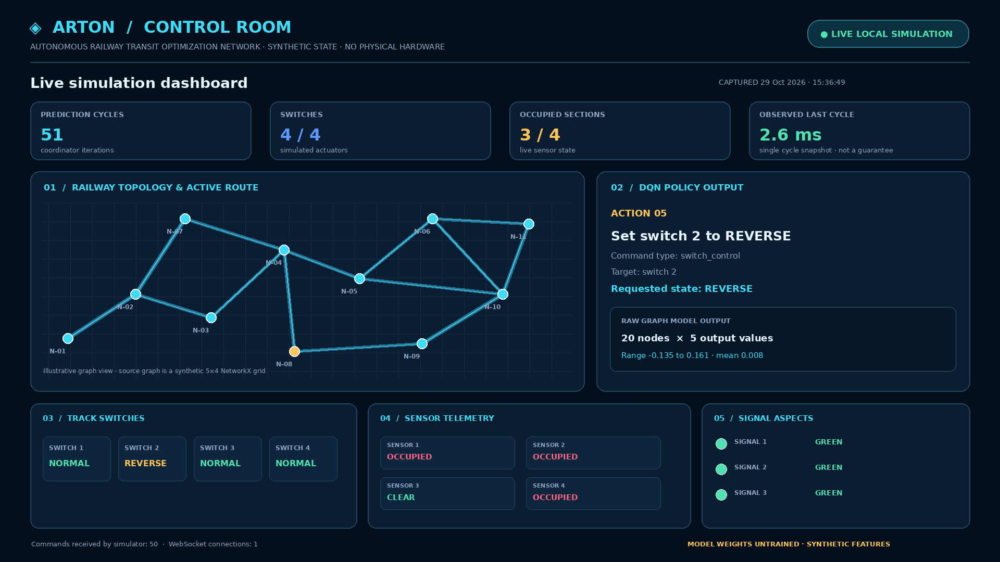
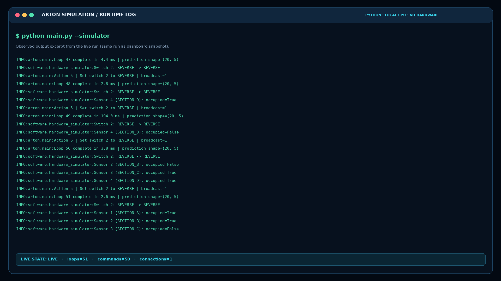

# ARTON — Autonomous Railway Transit Optimization Network

**Version:** `1.1.0` · **Status:** Academic prototype / software-only simulation · **License:** check the repository `LICENSE` file before redistribution

ARTON is a final-year project prototype exploring AI-assisted railway scheduling and trackside control. It combines a GraphSAGE-style graph model for multi-step output prediction, a Deep Q-Network (DQN) policy, a FastAPI/WebSocket communication layer, and a software simulator for ESP32-like trackside components.

> **Hardware is not required to run the demo.** The default simulation uses synthetic network features and randomly initialized model weights. It is intended for software integration demonstrations only—not safety-critical or live railway control.

## What's new in v1.1.0

- Added a pure-PyTorch GraphSAGE fallback so simulation works without PyTorch Geometric installed.
- Normalized graph edges to bidirectional message-passing edges when using NetworkX graphs.
- Standardized DQN actions to the simulator's supported `switch_control` and `signal_control` command schema.
- Connected the coordinator's prediction loop to the local WebSocket simulator and surfaced live status at the dashboard/API.
- Unified demo startup so the timed demo runs one server and one simulator rather than launching duplicate processes.
- Added simulator control/integration tests and live simulation screenshots.
- Added clearer caveats about synthetic inputs, untrained model weights, and non-certified performance.

## Screenshots from a live local simulation

The following captures were produced from a running local simulation (not mock UI data). They show an observed sample run; values can differ on each run.

### Control-room dashboard



### Runtime log and simulator command exchange



A structured snapshot from the same capture is also included at [`docs/screenshots/ARTON_Simulation_Evidence.json`](docs/screenshots/ARTON_Simulation_Evidence.json). Screenshots are evidence of a successful local integration run, not a benchmark or validation result.

## Prerequisites

### Required

- **Python 3.10 or newer**. Python 3.11 or 3.12 is a good choice for broad scientific-library wheel compatibility; the v1.1.0 smoke run was executed with Python 3.13.5.
- **pip** (comes with standard Python installers).
- **NetworkX** to construct the synthetic railway graph.
- **NumPy** and **PyTorch** for model inputs and inference.
- **FastAPI**, **Uvicorn**, and **WebSockets** for the local API and software-to-simulator link.
- A browser to open the dashboard.

No ESP32 board, sensors, railway equipment, GPU, database, cloud credentials, or internet connection are required after the Python packages have been installed.

### Optional

- **PyTorch Geometric**: if installed with a version compatible with your Python and PyTorch builds, ARTON uses its `SAGEConv` implementation. If absent, ARTON uses a small pure-PyTorch GraphSAGE fallback.
- A CUDA-enabled PyTorch build is optional; CPU mode is sufficient for the demonstration.

## Quick start (no hardware)

Commands below assume the repository has been cloned and the current directory is the project root.

### 1. Create and activate a virtual environment

**Windows PowerShell**

```powershell
py -3 -m venv .venv
.\.venv\Scripts\Activate.ps1
python -m pip install --upgrade pip
```

**Linux / macOS**

```bash
python3 -m venv .venv
source .venv/bin/activate
python -m pip install --upgrade pip
```

### 2. Install dependencies

```bash
python -m pip install -r arton_project/software/requirements.txt
```

The requirements file contains only the runtime dependencies required for the hardware-free demo. PyTorch may take some time to download. For a GPU-specific build, choose the correct PyTorch command for your platform from the official PyTorch installation selector, then install the remaining dependencies from `requirements.txt`.

### 3. Start the live simulation

```bash
cd arton_project/software
python main.py --simulator
```

Open the dashboard in a browser:

- Dashboard: <http://127.0.0.1:8000/dashboard>
- API status: <http://127.0.0.1:8000/api/state>
- Health/root: <http://127.0.0.1:8000/>

The dashboard reports prediction-loop activity, the last DQN command, simulated switch positions, occupancy sensor state, signal aspects, and recent events. Keep the terminal running while viewing the dashboard. Press **Ctrl+C** to stop the simulation.

### 4. Run an automatic timed demo

From `arton_project/software`:

```bash
python demo_artion.py --duration 30
```

This starts the API, prediction loop and in-process hardware simulator together, then shuts them down after 30 seconds. It avoids starting duplicate simulator processes.

You can also run the coordinator directly for a bounded simulation:

```bash
python main.py --simulator --duration 10
```

### 5. Run tests

From `arton_project/software`:

```bash
python test_artion.py
```

The test suite checks GraphSAGE output dimensions and finite values, DQN action selection and replay training, model-to-policy integration, simulator switch/signal commands, and telemetry component counts.

## Software modules

| File | Purpose |
|---|---|
| `arton_project/software/graphsage_model.py` | GraphSAGE-style network, optional PyTorch Geometric backend, pure-PyTorch fallback and synthetic feature generation |
| `arton_project/software/dqn_agent.py` | DQN network, experience replay and simulator-compatible action-to-command mapping |
| `arton_project/software/fastapi_server.py` | FastAPI endpoints, live dashboard, WebSocket connection manager and telemetry state |
| `arton_project/software/hardware_simulator.py` | Software-only simulator for 4 track switches, 4 occupancy sensors and 3 railway signals |
| `arton_project/software/main.py` | Coordinates prediction, routing, API startup, simulator lifecycle and graceful shutdown |
| `arton_project/software/demo_artion.py` | Timed, single-process local demonstration |
| `arton_project/software/test_artion.py` | Component and integration tests |
| `arton_project/software/requirements.txt` | Minimal runtime dependencies |
| `arton_project/software/DEMO_INSTRUCTIONS.md` | Run commands and troubleshooting notes |

## What the demo simulates

- A synthetic **5 × 4 NetworkX graph** containing 20 nodes.
- **10 features per node** and a five-value output vector per node from the GraphSAGE-style model.
- A **20-dimensional DQN state** and **10 discrete action IDs**.
- Local WebSocket control messages and simulator telemetry.
- **4 track switches**, **4 occupancy sensors**, and **3 railway signals**.
- A dashboard and event log that update from the running process.

## Troubleshooting

| Symptom | What to check |
|---|---|
| `ModuleNotFoundError` | Activate the virtual environment, then run `python -m pip install -r requirements.txt` from the repository root. |
| Port `8000` is already in use | Stop any previous ARTON process before starting another instance, or change the host/port in `main.py` and the simulator WebSocket URL together. |
| Dashboard says server offline | Confirm `python main.py --simulator` is still running and open `http://127.0.0.1:8000/dashboard`. |
| Simulator connection is missing | Check terminal logs for the WebSocket connection message; do not start a separate simulator when using `demo_artion.py`. |
| PyTorch Geometric import fails | This package is optional for the demo; the pure-PyTorch GraphSAGE fallback should be used automatically. |
| Prediction loop is slow on a laptop | Close other Python-heavy processes. `main.py` limits PyTorch CPU thread count for small-graph demo stability. Runtime numbers will vary by machine. |
| PowerShell blocks venv activation | Use an approved local execution policy or run the venv's Python executable directly without activating it. |

## Versioning

ARTON follows **Semantic Versioning**: `MAJOR.MINOR.PATCH`.

- **MAJOR** — incompatible API, model, or command-schema changes.
- **MINOR** — backward-compatible features such as new dashboard panels or simulator capabilities.
- **PATCH** — compatible bug fixes, test fixes and documentation corrections.

The application API reports version `1.1.0`. The canonical project version is recorded in [`VERSION`](VERSION); the release history is in [`CHANGELOG.md`](CHANGELOG.md).

## Scope, limitations and safety

- Inputs are synthetic; the current demo does not ingest live train timetables, station topology or real sensor telemetry.
- The model weights are randomly initialized and **not trained or calibrated**. Output values are raw model outputs—not delay minutes or validated forecasts.
- The DQN routing logic demonstrates a control loop; it is **not a trained or safety-validated railway policy**.
- Observed local cycle times are diagnostic snapshots and are not a latency guarantee.
- The project is not certified for safety-critical use. Real deployment would require validated railway data, training and held-out evaluation, interlocking constraints, fail-safe command validation, security review, hardware-in-the-loop testing, railway-domain review and applicable certification.

## License

Check the repository's `LICENSE` file before redistribution. If no `LICENSE` file is present in your checkout, confirm the project license with the maintainers before reusing or redistributing the code.

## Repository

Source: <https://github.com/JirayaD/artion-software>
